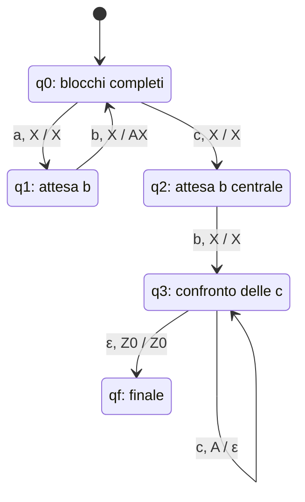

# Costruzione di automi a pila

Costruire un automa a pila significa tradurre i vincoli del linguaggio in:

- stati che distinguono le fasi della lettura;
- operazioni sulla pila che conservano le informazioni necessarie;
- condizioni precise per l’accettazione.

Gli stati controllano la struttura della parola. La pila permette di collegare quantità arbitrariamente grandi.

> [!important] Obiettivo
> Non basta descrivere un comportamento intuitivo.
>
> Bisogna specificare le transizioni e verificare che l’automa riconosca tutte e sole le parole richieste.
>
> Se viene richiesto un DPDA, bisogna anche controllare i vincoli di determinismo.

---

## 1. Metodo generale di costruzione

### Passo 1: dividere la parola in fasi

Individua parti con comportamenti diversi.

Per esempio, in:

$$
a^nb^n
$$

ci sono una fase di lettura delle `a` e una fase di lettura delle `b`.

### Passo 2: capire che cosa deve ricordare la pila

Chiediti quale informazione deve essere conservata durante una fase e utilizzata successivamente.

Spesso basta memorizzare un conteggio mediante simboli tutti uguali.

### Passo 3: individuare il cambio di fase

Il passaggio può essere determinato da:

- un simbolo separatore;
- un cambiamento nei simboli letti;
- una particolare cima della pila.

Se la costruzione richiede una scelta non determinata da queste informazioni, potrebbe essere necessario il non determinismo.

### Passo 4: scegliere quando inserire e rimuovere simboli

Deve esserci una corrispondenza precisa tra ciò che viene contato e le operazioni sulla pila.

### Passo 5: controllare i casi minimi

Verifica separatamente:

- parametri uguali a zero;
- parola vuota;
- blocchi che possono mancare;
- parti fisse che devono comunque essere presenti.

### Passo 6: definire l’accettazione

Specifica se usi lo stato finale o la pila vuota e controlla sempre il completo consumo dell’input.

---

## 2. Operazioni fondamentali sulla pila

Manteniamo la cima a sinistra.

| Operazione desiderata | Sostituzione della cima |
|---|---|
| Lasciare invariata la pila | $X\mapsto X$ |
| Inserire un simbolo $A$ | $X\mapsto AX$ |
| Rimuovere un simbolo $A$ | $A\mapsto\varepsilon$ |
| Controllare che non restino simboli di conteggio | Verificare che la cima sia $Z_0$ |

Nelle costruzioni che seguono, $Z_0$ viene conservato come marcatore di fondo.

> [!tip] Conta l’unità giusta
> Se il linguaggio collega il numero di blocchi `ab` a un’altra quantità, conviene inserire un simbolo per ogni blocco completo.
>
> Inserire un simbolo per ogni carattere del blocco produrrebbe un conteggio diverso.

---

## 3. Esercizio d’esame: analisi del linguaggio

Nella prova del 22 febbraio 2011 viene richiesto un DPDA per:

$$
\boxed{
L=\{(ab)^ncb\,c^n\mid n\geq0\}.
}
$$

Dividiamo la parola in quattro parti:

$$
\underbrace{(ab)^n}_{\text{blocchi da contare}}
\underbrace{c}_{\text{separatore}}
\underbrace{b}_{\text{simbolo obbligatorio}}
\underbrace{c^n}_{\text{confronto con il conteggio}}.
$$

Esempi:

| $n$ | Parola |
|---|---|
| $0$ | `cb` |
| $1$ | `abcbc` |
| $2$ | `ababcbcc` |

### Informazione da memorizzare

Inseriamo un simbolo $A$ per ogni blocco `ab` completato.

Dopo aver letto $(ab)^n$, vogliamo avere:

$$
A^nZ_0.
$$

Dopo il separatore `c` e la `b` obbligatoria, rimuoviamo un $A$ per ogni `c` finale.

> [!warning] Il caso n = 0
> Per $n=0$ la parola è `cb`, non $\varepsilon$.
>
> Le due parti variabili scompaiono, ma la parte fissa `cb` resta.

---

## 4. Scegliere gli stati

Usiamo cinque stati:

| Stato | Significato |
|---|---|
| $q_0$ | Siamo tra due blocchi `ab`, oppure prima del primo |
| $q_1$ | Abbiamo letto una `a` e aspettiamo la `b` che completa il blocco |
| $q_2$ | Abbiamo letto il separatore `c` e aspettiamo la `b` obbligatoria |
| $q_3$ | Leggiamo le `c` finali e rimuoviamo gli $A$ |
| $q_f$ | Stato finale |

La distinzione tra $q_0$ e $q_1$ impedisce di accettare un prefisso con un blocco incompleto.

La distinzione tra $q_2$ e $q_3$ impone la presenza della `b` centrale.

### Strategia di conteggio

Il simbolo $A$ viene inserito sulla transizione che legge la `b` del blocco `ab`.

Quindi il conteggio aumenta soltanto quando il blocco è completo.

---

## 5. Definizione formale dell’automa

Definiamo:

$$
M=(Q,\Sigma,\Gamma,\delta,q_0,Z_0,F),
$$

con:

$$
Q=\{q_0,q_1,q_2,q_3,q_f\},
$$

$$
\Sigma=\{a,b,c\},
$$

$$
\Gamma=\{A,Z_0\},
$$

$$
F=\{q_f\}.
$$

Adottiamo l’accettazione per stato finale.

### Transizioni

Nelle prime quattro righe, $X$ indica un qualunque simbolo di $\Gamma$:

$$
X\in\{A,Z_0\}.
$$

| Stato | Input | Cima | Nuovo stato | Sostituzione |
|---|---|---|---|---|
| $q_0$ | $a$ | $X$ | $q_1$ | $X$ |
| $q_1$ | $b$ | $X$ | $q_0$ | $AX$ |
| $q_0$ | $c$ | $X$ | $q_2$ | $X$ |
| $q_2$ | $b$ | $X$ | $q_3$ | $X$ |
| $q_3$ | $c$ | $A$ | $q_3$ | $\varepsilon$ |
| $q_3$ | $\varepsilon$ | $Z_0$ | $q_f$ | $Z_0$ |

Tutte le altre transizioni sono non definite.

Equivalentemente:

$$
\begin{aligned}
\delta(q_0,a,X)&=(q_1,X)\\
\delta(q_1,b,X)&=(q_0,AX)\\
\delta(q_0,c,X)&=(q_2,X)\\
\delta(q_2,b,X)&=(q_3,X)\\
\delta(q_3,c,A)&=(q_3,\varepsilon)\\
\delta(q_3,\varepsilon,Z_0)&=(q_f,Z_0).
\end{aligned}
$$

La lettera $X$ è un’abbreviazione per due transizioni concrete, non un ulteriore simbolo della pila.

### Rappresentazione del comportamento

Nel diagramma, un’etichetta `x, X / γ` indica: leggi `x` e sostituisci la cima `X` con `γ`.

---

## 6. Simulazione per n = 2

Consideriamo:

$$
w=(ab)^2cb\,c^2,
$$

cioè `ababcbcc`.

| Passo | Stato | Input rimanente | Pila |
|---|---|---|---|
| 0 | $q_0$ | `ababcbcc` | $Z_0$ |
| 1 | $q_1$ | `babcbcc` | $Z_0$ |
| 2 | $q_0$ | `abcbcc` | $AZ_0$ |
| 3 | $q_1$ | `bcbcc` | $AZ_0$ |
| 4 | $q_0$ | `cbcc` | $AAZ_0$ |
| 5 | $q_2$ | `bcc` | $AAZ_0$ |
| 6 | $q_3$ | `cc` | $AAZ_0$ |
| 7 | $q_3$ | `c` | $AZ_0$ |
| 8 | $q_3$ | $\varepsilon$ | $Z_0$ |
| 9 | $q_f$ | $\varepsilon$ | $Z_0$ |

Ogni blocco `ab` ha inserito un $A$.

Ogni `c` finale ne ha rimosso uno.

La parola è accettata perché l’input è esaurito e lo stato raggiunto è finale.

---

## 7. Verifica del caso n = 0

Per `cb`:

$$
(q_0,cb,Z_0)
\vdash
(q_2,b,Z_0)
\vdash
(q_3,\varepsilon,Z_0)
\vdash
(q_f,\varepsilon,Z_0).
$$

La parola viene accettata senza inserire alcun $A$.

Questo è possibile perché le transizioni che leggono il separatore e la `b` centrale sono definite anche con cima $Z_0$.

Se fossero definite soltanto con cima $A$, perderemmo il caso $n=0$.

---

## 8. Perché l’automa è deterministico

### Unicità dei risultati

Ogni tripla stato-input-cima ha al massimo un risultato.

In $q_0$ sono presenti transizioni su `a` e su `c`, ma il prossimo simbolo determina quale applicare.

### Assenza di competizione con epsilon

L’unica mossa epsilon è:

$$
\delta(q_3,\varepsilon,Z_0)=(q_f,Z_0).
$$

Con la coppia $(q_3,Z_0)$ non esiste alcuna transizione che consumi input.

La lettura delle `c` finali usa invece la cima $A$:

$$
\delta(q_3,c,A)=(q_3,\varepsilon).
$$

Le due mosse non competono perché richiedono cime differenti.

> [!important] Il controllo va fatto sulla coppia stato-cima
> La presenza, nello stesso stato, di una mossa epsilon e di una mossa che legge input è consentita quando le cime richieste sono diverse.

---

## 9. Dimostrazione di correttezza

### Ogni parola accettata appartiene al linguaggio

Prima del separatore, l’automa può leggere soltanto blocchi `ab`:

- da $q_0$ legge `a`;
- da $q_1$ deve leggere `b`;
- torna quindi in $q_0$.

Dopo $n$ blocchi la pila contiene:

$$
A^nZ_0.
$$

Il separatore `c` può essere letto soltanto da $q_0$, quindi non può interrompere un blocco.

Da $q_2$ deve poi essere letta la `b` obbligatoria.

Infine, in $q_3$:

- ogni `c` rimuove un $A$;
- non possono essere letti altri simboli;
- si raggiunge $q_f$ soltanto quando resta $Z_0$.

Per accettare, devono quindi esserci esattamente $n$ `c` finali e nessun input residuo.

Ogni parola accettata ha pertanto la forma:

$$
(ab)^ncb\,c^n.
$$

### Ogni parola del linguaggio è accettata

Per qualsiasi $n\geq0$:

$$
\begin{aligned}
(q_0,(ab)^ncb\,c^n,Z_0)
&\vdash^*(q_0,cb\,c^n,A^nZ_0)\\
&\vdash(q_2,b\,c^n,A^nZ_0)\\
&\vdash(q_3,c^n,A^nZ_0)\\
&\vdash^*(q_3,\varepsilon,Z_0)\\
&\vdash(q_f,\varepsilon,Z_0).
\end{aligned}
$$

Quindi:

$$
\boxed{L_F(M)=L.}
$$

---

## 10. Parole di controllo ed errori frequenti

| Parola | Esito | Motivo |
|---|---|---|
| `cb` | Accettata | Caso $n=0$ |
| `abcbc` | Accettata | Caso $n=1$ |
| `ababcbcc` | Accettata | Caso $n=2$ |
| `c` | Rifiutata | Manca la `b` obbligatoria |
| `cbc` | Rifiutata | Nessun blocco `ab`, ma una `c` finale |
| `abcb` | Rifiutata | Manca una `c` finale |
| `abcbcc` | Rifiutata | Una `c` finale di troppo |
| `acbc` | Rifiutata | Il primo blocco `ab` è incompleto |

Gli errori principali sono:

- contare separatamente `a` e `b`, anziché i blocchi `ab`;
- permettere il separatore dopo una `a` non ancora seguita da `b`;
- dimenticare la `b` centrale;
- escludere involontariamente $n=0$;
- accettare appena si raggiunge $q_f$, senza verificare l’esaurimento dell’input.

> [!tip] Come presentare la soluzione all’esame
> Spiega prima che cosa ricordano gli stati e che cosa conta la pila.
>
> Poi scrivi transizioni, stato iniziale e stati finali. Concludi controllando il caso minimo, il determinismo e la corrispondenza tra parole accettate e linguaggio richiesto.