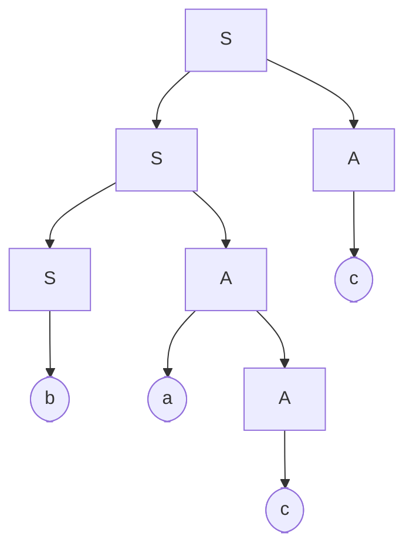

# Analisi sintattica e riconoscimento

L’analisi sintattica verifica che una sequenza di token rispetti una grammatica e ne individua la struttura.

Questa struttura permette di capire, per esempio:

- quali operatori si applicano a quali operandi;
- quali dichiarazioni appartengono a un record;
- quali istruzioni appartengono al corpo di un ciclo.

In questo capitolo studieremo soprattutto l’analisi ascendente e i metodi LR(0) e SLR(1).

> [!important] Collegamento con l’esame
> Gli esercizi richiedono di costruire automi LR(0), classificare grammatiche e simulare il riconoscimento di parole.
>
> Per affrontarli bisogna distinguere tre questioni:
> - la parola appartiene al linguaggio?
> - quale struttura sintattica possiede?
> - la grammatica può essere analizzata con il metodo richiesto?

---

## 1. Riconoscimento e analisi sintattica

Consideriamo una grammatica context-free:

$$
G=(N,\Sigma,P,S).
$$

### Riconoscimento

Il problema del riconoscimento consiste nello stabilire, data una parola $w\in\Sigma^*$, se:

$$
\boxed{w\in L(G).}
$$

Equivalentemente, bisogna verificare se:

$$
S\Rightarrow_G^*w.
$$

Il risultato è una risposta sì/no.

### Analisi sintattica

L’analisi sintattica, o parsing, individua anche una struttura che giustifica l’appartenenza della parola al linguaggio.

Questa struttura può essere rappresentata mediante:

- un albero di derivazione;
- una derivazione;
- una sequenza di riduzioni che permetta di ricostruire l’albero.

| Problema | Domanda |
|---|---|
| Riconoscimento | La parola appartiene al linguaggio? |
| Analisi sintattica | Come è organizzata secondo la grammatica? |

Un parser può eseguire azioni semantiche durante l’analisi, anche senza costruire esplicitamente l’intero albero in memoria.

---

## 2. L’ingresso del parser è una sequenza di token

Nel contesto della compilazione, il parser riceve normalmente i token prodotti dall’analizzatore lessicale.

Per esempio:

```text
x + 27
```

può essere trasformato nella sequenza:

```text
id + num
```

Il token `id` identifica la categoria “identificatore”; `x` è il suo lessèma.

Il token `num` identifica una costante numerica; `27` è il suo lessèma.

La grammatica sintattica lavora con le categorie dei token, mantenendo eventualmente associate informazioni come nome e valore.

### Distinguere i livelli di controllo

In un semplice linguaggio di espressioni:

| Espressione | Osservazione |
|---|---|
| `x + y` | Può essere sintatticamente corretta |
| `x + * y` | La sequenza degli operatori è sintatticamente scorretta |
| `x + y`, con `y` non dichiarato | Può essere sintatticamente corretta ma semanticamente scorretta |

> [!important] Sintassi e semantica
> La grammatica descrive la struttura delle espressioni.
>
> Controlli come l’esistenza di una dichiarazione o la compatibilità dei tipi richiedono informazioni semantiche.

Negli esercizi con terminali `a`, `b`, `c`, ogni lettera rappresenta direttamente un simbolo dell’alfabeto della grammatica.

---

## 3. Alberi di derivazione e ambiguità

Per una parola riconosciuta, l’albero mostra quali produzioni sono state applicate e come sono organizzate le loro occorrenze.

La frontiera dell’albero, letta da sinistra a destra, deve coincidere con la parola.

Se una stessa parola possiede più alberi distinti, la grammatica è ambigua.

In questo caso:

- il riconoscimento può comunque rispondere sì;
- la struttura sintattica non è univoca.

Per esempio, con:

$$
E\to E+E\mid E*E\mid id,
$$

la parola:

$$
id+id*id
$$

ha due strutture differenti.

> [!warning] Appartenenza e unicità sono proprietà diverse
> Dimostrare che una parola è generabile non dimostra che abbia un solo albero.
>
> Per l’analisi deterministica bisogna poter scegliere correttamente le azioni del parser.

---

## 4. Il marcatore di fine input

Nelle prove d’esame compare il simbolo:

$$
\downarrow
$$

come marcatore di fine input.

Per esempio, la parola significativa può essere:

$$
bacc,
$$

mentre l’ingresso del riconoscitore è:

$$
bacc\downarrow.
$$

Il marcatore permette di rendere esplicita la fine della sequenza da analizzare.

### Convenzione usata nelle prove

Gli esercizi introducono una produzione aumentata del tipo:

$$
S'\to S\downarrow.
$$

Con questa convenzione, la grammatica aumentata genera:

$$
L(G')=\{w\downarrow\mid w\in L(G)\}.
$$

Il nuovo simbolo iniziale è $S'$.

La parola senza marcatore appartiene al linguaggio della grammatica originale; quella con marcatore appartiene al linguaggio aumentato.

> [!tip] Controllo iniziale
> Prima di costruire l’automa LR, copia esattamente la produzione aumentata indicata nel testo.
>
> La posizione del marcatore influisce sugli item e sul riconoscimento conclusivo.

---

## 5. Analisi discendente e ascendente

### Analisi discendente

Parte dal simbolo iniziale e costruisce la struttura verso i terminali:

$$
S\Rightarrow^*\ w.
$$

Nei comuni metodi discendenti si ricostruisce una derivazione sinistra.

Il parser decide quali produzioni usare per espandere i non terminali.

### Analisi ascendente

Parte dai terminali dell’input e ricostruisce progressivamente le strutture grammaticali.

Quando riconosce il lato destro di una produzione:

$$
A\to\beta,
$$

può effettuare una riduzione:

$$
\beta\rightsquigarrow A.
$$

Nei metodi LR, le riduzioni ricostruiscono una derivazione destra in ordine inverso.

| Aspetto | Discendente | Ascendente LR |
|---|---|---|
| Punto di partenza concettuale | Simbolo iniziale | Terminali dell’input |
| Operazione caratteristica | Espansione | Riduzione |
| Costruzione dell’albero | Dalla radice alle foglie | Dalle foglie alla radice |
| Derivazione ricostruita | Sinistra, nei metodi standard | Destra, in ordine inverso |

> [!important] Direzione di lettura
> Un parser LR legge l’input da sinistra a destra.
>
> “Derivazione destra in ordine inverso” descrive il rapporto tra riduzioni e derivazione, non una lettura dell’input da destra a sinistra.

---

## 6. Esempio d’esame: riconoscere bacc

Nella prova del 22 febbraio 2011 compare la grammatica:

$$
S\to SA\mid b
$$

$$
A\to aA\mid c.
$$

Consideriamo:

$$
w=bacc.
$$

La parola è generabile.

Una derivazione destra è:

$$
\begin{aligned}
S
&\Rightarrow SA\\
&\Rightarrow Sc\\
&\Rightarrow SAc\\
&\Rightarrow SaAc\\
&\Rightarrow Sacc\\
&\Rightarrow bacc.
\end{aligned}
$$

A ogni passo viene espanso il non terminale più a destra.

### Struttura della parola

La parola contiene:

- il terminale iniziale `b`;
- una prima occorrenza di $A$ che genera `ac`;
- una seconda occorrenza di $A$ che genera `c`.

L’albero corrispondente è:



La frontiera è:

$$
b\ a\ c\ c.
$$

Questo albero giustifica l’appartenenza di `bacc` al linguaggio.

---

## 7. Ricostruzione ascendente della stessa derivazione

Invertendo la derivazione destra otteniamo:

$$
\begin{aligned}
bacc
&\rightsquigarrow Sacc\\
&\rightsquigarrow SaAc\\
&\rightsquigarrow SAc\\
&\rightsquigarrow Sc\\
&\rightsquigarrow SA\\
&\rightsquigarrow S.
\end{aligned}
$$

Le riduzioni applicate sono:

| Passo | Produzione usata al contrario |
|---|---|
| $bacc\rightsquigarrow Sacc$ | $S\to b$ |
| $Sacc\rightsquigarrow SaAc$ | $A\to c$, sulla prima `c` |
| $SaAc\rightsquigarrow SAc$ | $A\to aA$ |
| $SAc\rightsquigarrow Sc$ | $S\to SA$ |
| $Sc\rightsquigarrow SA$ | $A\to c$ |
| $SA\rightsquigarrow S$ | $S\to SA$ |

La sequenza descrive le riduzioni su forme complete.

Una simulazione LR aggiungerà:

- la pila;
- gli stati del riconoscitore;
- l’input ancora da leggere;
- le decisioni prese mediante le tabelle.

> [!warning] Le riduzioni devono essere appropriate
> Trovare una sottostringa uguale al lato destro di una produzione non basta per scegliere correttamente una riduzione.
>
> I metodi LR usano il contesto rappresentato dagli stati e, quando previsto, dal lookahead.

---

## 8. Le operazioni di un parser ascendente

Nei metodi a spostamento e riduzione incontreremo quattro esiti principali.

| Operazione | Significato |
|---|---|
| Spostamento, o shift | Consuma il prossimo token e aggiorna la pila |
| Riduzione, o reduce | Riconosce un lato destro e lo sostituisce con il non terminale corrispondente |
| Accettazione | L’analisi completa ha riconosciuto la parola |
| Errore | La configurazione corrente non ammette una continuazione prevista dal metodo |

Le tabelle LR indicano quale azione eseguire e quale stato raggiungere.

### Significato del nome LR(0)

- **L:** lettura dell’input da sinistra a destra.
- **R:** ricostruzione di una derivazione destra in ordine inverso.
- **0:** le decisioni di riduzione non usano simboli di lookahead per selezionare la riduzione.

Il parser deve comunque leggere il prossimo simbolo quando effettua uno spostamento.

La definizione operativa verrà precisata nelle note su item, automa e tabelle LR(0).

---

## 9. Appartenenza della parola e classificazione della grammatica

Sono domande differenti:

$$
w\in L(G)?
$$

e:

$$
G\text{ è LR(0)?}
$$

La prima riguarda una parola e il linguaggio generato.

La seconda riguarda la possibilità di analizzare la grammatica con uno specifico metodo deterministico.

Una grammatica che presenta conflitti LR(0) può essere analizzabile con un metodo più potente, per esempio SLR(1).

Un conflitto nella costruzione LR(0) non dimostra che una particolare parola sia estranea al linguaggio.

> [!important] Separare i risultati
> Negli esercizi bisogna distinguere:
> - costruzione dell’automa;
> - verifica dei conflitti;
> - classificazione della grammatica;
> - simulazione sulla parola richiesta.

---

## 10. Errori da evitare e procedura di studio

Gli errori principali sono:

- confondere i caratteri del programma con i token del parser;
- confondere correttezza sintattica e correttezza semantica;
- considerare il marcatore finale come parte della parola originale;
- pensare che LR legga l’input da destra a sinistra;
- invertire una derivazione sinistra quando si vuole descrivere il funzionamento LR;
- scegliere una riduzione soltanto perché coincide con una produzione;
- interpretare un conflitto LR(0) come rifiuto della parola.

Per preparare un esercizio:

1. Individua simbolo iniziale, terminali e produzioni.
2. Controlla la grammatica aumentata e il marcatore finale.
3. Cerca una derivazione della parola per comprenderne la struttura.
4. Collega le riduzioni alla derivazione destra inversa.
5. Costruisci il riconoscitore con il metodo richiesto.
6. Simula le azioni controllando pila, stato e input residuo.

> [!important] Collegamento centrale
> La grammatica definisce quali strutture sono ammesse.
>
> Il riconoscitore stabilisce l’appartenenza della parola.
>
> Il parser ricostruisce la struttura mediante una procedura precisa.